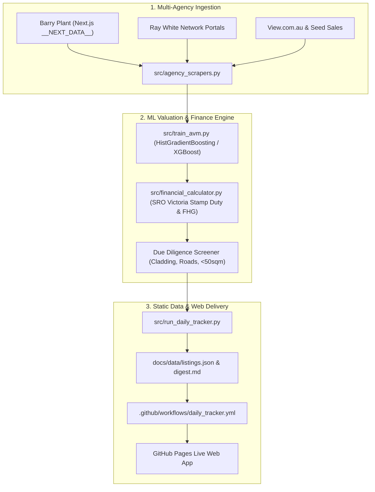

# 🏙️ Melbourne Property Tracker

> **Real Estate Valuation, Underquoting Detection & First-Home Buyer Financial Engine for Greater Melbourne.**

[](https://github.com/rammsec/MelbournePropertyTracker/actions/workflows/daily_tracker.yml)
[](https://rammsec.github.io/MelbournePropertyTracker/)
[](https://www.python.org/)
[](https://postgis.net/)

---

## 🌐 Live Web App

Access the interactive dashboard anytime from any phone or computer without installing Python:  
👉 **[https://rammsec.github.io/MelbournePropertyTracker/](https://rammsec.github.io/MelbournePropertyTracker/)**

Features:
- **Interactive Leaflet Map**: Geo-located active listings color-coded by underquoting risk.
- **Daily Market Intelligence Digest**: Top 5 auction bait traps, motivated vendor opportunities, and First-Home Buyer value picks.
- **Victorian FHB Cash-to-Close Calculator**: Real-time Victorian Land Transfer Duty (Stamp Duty), Federal First Home Guarantee (FHG) 5% deposit assessment, and upfront cost breakdowns.
- **Due Diligence Red-Flag Screener**: Combustible cladding watchlist (e.g. Lacrosse tower), borrowed-light inboard bedrooms, and <50 sqm bank LVR caps.

---

## 🎯 Key Problems Solved

1. **Underquoting & Auction Baits**: Detects when agent price guides are listed far below true fair value, saving buyers wasted legal review and inspection fees.
2. **First-Home Buyer Clarity**: Automatically computes exact progressive stamp duty exemptions ($\le \$600\text{k}$) and concessions ($\$600\text{k} - \$750\text{k}$), plus Federal 5% deposit eligibility under the $\$950\text{k}$ Melbourne cap.
3. **Property Red-Flag Screener**: Screens cadastre records against known high-density cladding watchlists, arterial road traffic noise, and sub-50 sqm apartment bank lending limits.
4. **Motivated Seller Detection**: Audits historical price guides to spot genuine price cuts and stale campaigns.

---

## 📊 Underquoting Risk Tiers

| Risk Tier | Indicator | Criteria | Typical Buyer Action |
|---|---|---|---|
| 🔴 **High Risk / Auction Bait** | Red Badge | AVM Fair Value $>12\%$ above top guide | Expect vendor reserve to be significantly higher than quote on auction day. |
| 🟠 **Moderate Risk** | Amber Badge | AVM Fair Value $5\% - 12\%$ above top guide | Healthy buffer required; expect competitive auction bidding. |
| 🟢 **Low Risk (Accurate Guide)** | Green Badge | Guide within $\pm 5\%$ of AVM Fair Value | Transparent pricing aligned with historical comparable sales. |
| 💎 **Motivated / Price Cut** | Cyan Badge | Listed below AVM or active price reductions | Excellent private treaty negotiation leverage. |

---

## 🏗️ Architecture



---

## 📂 Repository Layout

```text
MelbournePropertyTracker/
├── .github/
│   └── workflows/
│       └── daily_tracker.yml    # Daily cron workflow (8:00 AM AEDT) + Pages deployment
├── config/
│   ├── .env.example             # Database, Mapbox, and webhook environment variables
│   └── settings.py              # Central application configuration
├── data/
│   ├── sample_active_listings.csv
│   └── sample_vgvr_settled_sales.csv
├── database/
│   └── schema.sql               # PostgreSQL + PostGIS spatial schema with triggers
├── docs/                        # Static Web Dashboard (GitHub Pages)
│   ├── index.html               # Main dashboard UI
│   ├── styles.css               # Luxury dark-theme stylesheet
│   ├── app.js                   # Client-side map & financial calculation engine
│   └── data/
│       ├── listings.json        # 400+ scored Melbourne properties
│       ├── settled_sales.json   # 500+ historical settled comps
│       ├── metadata.json        # Model metrics & system timestamp
│       └── digest.md            # Daily Markdown intelligence report
├── src/
│   ├── agency_scrapers.py       # Barry Plant & Ray White direct web scrapers
│   ├── alerts.py                # Deal notification & webhook dispatcher
│   ├── dashboard.py             # Streamlit 3D geospatial dashboard
│   ├── database.py              # SQLAlchemy 2.0 + GeoAlchemy2 ORM layer
│   ├── etl_pipeline.py          # Victorian address normalizer & price parser
│   ├── financial_calculator.py  # SRO Stamp Duty & First-Home Buyer Cash-to-Close
│   ├── run_daily_tracker.py     # End-to-end pipeline CLI runner
│   └── train_avm.py             # Machine Learning AVM & underquoting detector
└── requirements.txt             # Project dependencies
```

---

## 🚀 Local Quickstart

### 1. Clone & Set Up Virtual Environment

```bash
git clone https://github.com/rammsec/MelbournePropertyTracker.git
cd MelbournePropertyTracker

python3 -m venv .venv
source .venv/bin/activate
pip install -r requirements.txt
```

### 2. Run the Daily Ingestion Pipeline

To ingest live listings, retrain the AVM model, and refresh `docs/data/`:

```bash
python -m src.run_daily_tracker
```

### 3. Launch Local Streamlit Dashboard (Optional)

```bash
streamlit run src/dashboard.py
```

### 4. Preview the Static Web App Locally

```bash
python -m http.server 8000 --directory docs
# Open http://localhost:8000 in your browser
```

---

## ⏰ Automated Daily Updates

The repository includes a scheduled GitHub Actions workflow [`.github/workflows/daily_tracker.yml`](.github/workflows/daily_tracker.yml) that automatically runs every morning at **8:00 AM AEDT (21:00 UTC)**:
1. Ingests fresh listings from agency portals.
2. Trains the gradient-boosted valuation model ($R^2 \approx 0.92$, $\text{MAPE} < 10\%$).
3. Computes underquoting risk scores and SRO Victoria Cash-to-Close figures.
4. Updates `docs/data/listings.json` and `docs/data/digest.md`.
5. Commits data updates to `main` and redeploys to GitHub Pages.

---

## 📜 License

MIT License. Developed for Victorian property seekers and First-Home Buyers.
